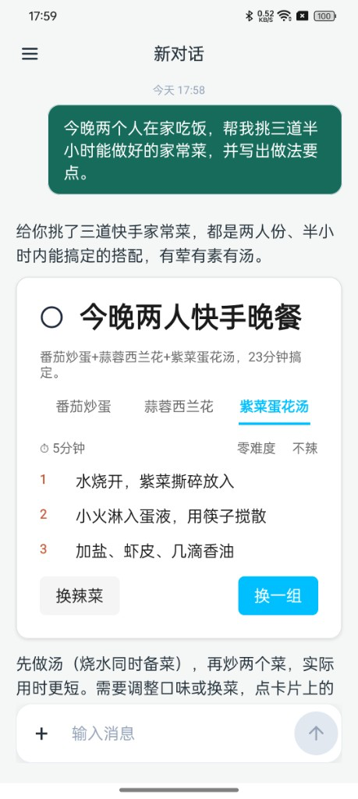

# KuiklyChat

基于 [KuiklyUI](https://github.com/Tencent-TDS/KuiklyUI) 跨端框架构建的聊天 UI 组件库，支持 Android、iOS、鸿蒙、JS / macOS。

> 当前版本是 `1.0.5`。宿主按下面的模块依赖；接入和使用示例见 [`docs/api/usage.md`](docs/api/usage.md)，参数说明见 [`docs/api/chat-ui.md`](docs/api/chat-ui.md)。

<div align="center">
  
  
  
</div>

## 模块

| 模块 | Maven 坐标 | 内容 |
|------|------------|------|
| 模型与 `ChatController` | `com.tencent.kuiklybase:kuiklychat-core` | `ChatMessage`、`AgentCard`、发送与流式状态 |
| Compose Chat UI | `com.tencent.kuiklybase:kuiklychat-compose` | `ChatScreen`。传递 `kuiklychat-core` |
| Kuikly DSL 会话页 | `com.tencent.kuiklybase:kuiklychat-compat` | `ChatControllerSession`、频道列表、输入区。传递 `core` 和 `ai` |
| KuiklyAI | `com.tencent.kuiklybase:kuiklychat-ai` | `LlmProvider`、`rememberLlmChatController` |
| Preview / Mock | `com.tencent.kuiklybase:kuiklychat-testing` | 显式依赖，UI 模块不会带上它 |
| Android 图片与字节缓存 | `com.tencent.kuiklybase:KuiklyChatAndroid` | 见 [`KuiklyChatAndroid/README.md`](KuiklyChatAndroid/README.md) |

版本后缀跟 Kotlin 版本走：标准平台 `1.0.5-2.1.21`，鸿蒙 `1.0.5-2.0.21-KBA-010`。

Compose Chat UI 的 Markdown 渲染使用外网公开的 `com.tencent.kuiklybase:markdown:0.4.1`；鸿蒙对应 `0.4.1-ohos`。Kuikly DSL 会话页使用外网公开的 `com.tencent.kuiklybase:KuiklyMarkdown:1.0.6-2.1.21`。Compose 组件和 DSL 组件同时接入时，Android 宿主需排除重复的 `org.jetbrains:markdown` parser，示例见 [`docs/api/usage.md`](docs/api/usage.md)。

## 接入指南

### 1. 添加 Maven 仓库

**标准平台（Android / iOS / JS / macOS）**

在 `settings.gradle.kts` 中添加：

```kotlin
dependencyResolutionManagement {
    repositories {
        google()
        mavenCentral()
        maven {
            url = uri("https://mirrors.tencent.com/repository/maven/kuikly-open/")
        }
        maven {
            url = uri("https://mirrors.tencent.com/nexus/repository/maven-tencent/")
        }
    }
}
```

**鸿蒙平台（HarmonyOS）**

在 `settings.ohos.gradle.kts` 中使用同一组仓库；版本换成 `1.0.5-2.0.21-KBA-010`，公开 Markdown 依赖由 `markdown:0.4.1-ohos` 提供。`kuikly-open` 提供 ChatUI 与公开 Markdown 产物，`maven-tencent` 提供 KBA 专用 kotlinx 产物。

### 2. 添加依赖

**标准平台（Android / iOS / JS / macOS）**

```kotlin
kotlin {
    sourceSets {
        val commonMain by getting {
            dependencies {
                implementation("com.tencent.kuiklybase:kuiklychat-compose:1.0.5-2.1.21")
                // 只要 Kuikly DSL 会话页时改用 kuiklychat-compat
                // Preview / Mock：kuiklychat-testing
            }
        }
    }
}
```

**鸿蒙平台（HarmonyOS）**

把版本换成 `1.0.5-2.0.21-KBA-010`。

本地工程把坐标换成 `implementation(project(":kuiklychat-compose"))` 即可。

聊天 UI 只有两套入口，共用 `ChatController`。

- Kuikly DSL：`ChatControllerSession`（`kuiklychat-compat`）
- Kuikly Compose DSL：`ChatScreen`（`kuiklychat-compose`）

```kotlin
val controller = ChatController(
    currentUser = ChatUser(id = "me", name = "我"),
    scope = scope,
    sender = ChatMessageSender { message ->
        flow {
            emit(ChatStreamEvent.TextDelta(text = "收到：${message.text}"))
            emit(ChatStreamEvent.Completed)
        }
    },
)

// Kuikly DSL。父容器需要确定高度，例如 flex(1f)。
ChatControllerSession(
    controller = controller,
)

// Kuikly Compose DSL
ChatScreen(controller = controller)
```

`sendText` 在文本为空或正在发送时返回 `false`。页面销毁时调用 `controller.dispose()` 并取消 `scope`。

---

## 消息与 Agent 卡片

消息模型在 `kuiklychat-core`：`ChatMessage` 加有序的 `MessagePart`（文本、附件、系统提示、`AgentCardContent`）。`AgentCard` 是共享卡片数据，类型包括代码块、命令、文件编辑、工具调用、思考、搜索、加载、错误、链接、表格、图表和计划。

两套 UI 目前都把卡片收成文字：Kuikly DSL 会话页用一行标签，Compose 气泡里显示卡片类型名。自定义渲染时，DSL 传 `ChatControllerSession` 的 `renderMessage`（返回 `true` 就跳过默认正文），Compose 换 `ChatScreen` 的 `rendererRegistry`。

LLM 接入在 `kuiklychat-ai`。`LlmProvider` 负责请求，Compose 页面用 `rememberLlmChatController` 持有会话。`kuiklychat-compat` 已经传递这个模块。

---

## 引用回复

`ChatMessage.replyToId` 指向被引用消息，展示摘要放在 `quotedPreview`。`ChatMessageHelper.createTextMessage` 返回同一套 `ChatMessage`。

```kotlin
val reply = ChatMessage(
    id = "user-2",
    author = ChatUser(id = "me", name = "我"),
    parts = listOf(MessagePart.Text("这是我的回复")),
    outgoing = true,
    replyToId = "user-1",
)
```

---

## License

MIT License
