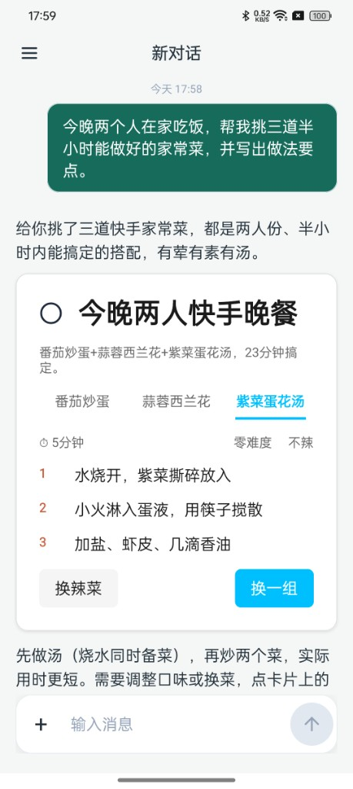
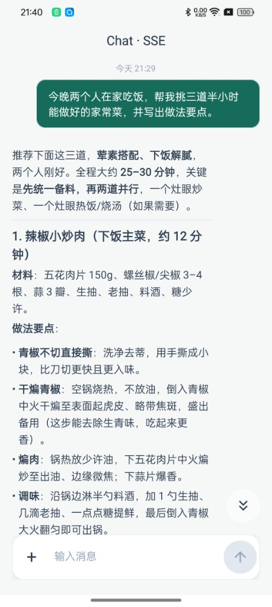

# KuiklyChat

基于 [KuiklyUI](https://github.com/Tencent-TDS/KuiklyUI) 跨端框架构建的聊天 UI 组件库，支持 Android、iOS、鸿蒙多端运行。

> **0.x experimental。** 当前 public 面（卡片工厂、Slot、AG-UI 映射）仍偏大，不要当 Stable 冻结。按需依赖子模块；旧 `KuiklyChat` 坐标是过渡伞，**不再传递 testing**。完整说明见 [`docs/api/host-integration.md`](docs/api/host-integration.md)。

<div align="center">
  
  
</div>

## 接入指南

### 1. 添加 Maven 仓库

**标准平台（Android / iOS / JS / macOS）**

在 `settings.gradle.kts` 中添加：

```kotlin
dependencyResolutionManagement {
    repositories {
        google()
        mavenCentral()
        maven {
            url = uri("https://mirrors.tencent.com/repository/maven-tencent/")
        }
    }
}
```

**鸿蒙平台（HarmonyOS）**

在 `settings.ohos.gradle.kts` 中添加：

```kotlin
dependencyResolutionManagement {
    repositories {
        google()
        mavenCentral()
        maven {
            url = uri("https://mirrors.tencent.com/repository/maven-tencent/")
        }
    }
}
```

### 2. 添加依赖（按需，不要默认全家桶）

版本示例：`0.1.0-experimental-2.1.21`（标准）/ `0.1.0-experimental-2.0.21-KBA-010`（鸿蒙）。

| 你要什么 | Maven 坐标 |
|----------|------------|
| Compose Chat UI | `com.tencent.kuiklybase:kuiklychat-compose` |
| Kuikly DSL 会话页 | `com.tencent.kuiklybase:kuiklychat-compat` |
| AG-UI 协议 | `com.tencent.kuiklybase:kuiklychat-agui` |
| Agent 卡片 | `com.tencent.kuiklybase:kuiklychat-agentcard` |
| KuiklyAI | `com.tencent.kuiklybase:kuiklychat-ai` |
| Preview / Mock | `com.tencent.kuiklybase:kuiklychat-testing`（**必须显式依赖**） |
| 过渡伞（不含 testing） | `com.tencent.kuiklybase:KuiklyChat` |

**标准平台（Android / iOS / JS / macOS）**

```kotlin
kotlin {
    sourceSets {
        val commonMain by getting {
            dependencies {
                implementation("com.tencent.kuiklybase:kuiklychat-compose:0.1.0-experimental-2.1.21")
                // 只要 Kuikly DSL 会话页时改用 kuiklychat-compat
                // 协议 / 卡片 / AI 按需追加 kuiklychat-agui / kuiklychat-agentcard / kuiklychat-ai
            }
        }
    }
}
```

**鸿蒙平台（HarmonyOS）**

```kotlin
kotlin {
    sourceSets {
        val commonMain by getting {
            dependencies {
                implementation("com.tencent.kuiklybase:kuiklychat-compose:0.1.0-experimental-2.0.21-KBA-010")
            }
        }
    }
}
```

聊天 UI 只有两套入口，共用 `ChatController`。完整参数表见 [`docs/api/chat-ui.md`](docs/api/chat-ui.md)。

- Kuikly DSL：`ChatControllerSession`（`kuiklychat-compat`）
- Kuikly Compose DSL：`ChatScreen`（`kuiklychat-compose`）

```kotlin
val controller = ChatController(
    currentUser = ChatUser(id = "me", name = "我"),
    scope = scope,
    sender = ChatMessageSender { message ->
        flow {
            emit(ChatStreamEvent.TextDelta(text = "收到：${message.text}"))
            emit(ChatStreamEvent.Completed)
        }
    },
)

// Kuikly DSL
ChatControllerSession(
    controller = controller,
    composerBottomInset = pagerData.safeAreaInsets.bottom,
)

// Kuikly Compose DSL
ChatScreen(controller = controller)
```

`sendText` 在文本为空或正在发送时返回 `false`。页面销毁时调用 `controller.dispose()` 并取消 `scope`。

---

## AG-UI 协议集成

可选模块 `kuiklychat-agui`，包名 `com.tencent.kuiklybase.chat.agui`。协议解析和 `ChatController` 分开：会话 UI 不直接依赖 AG-UI 类型。事件说明见 [AG-UI events](https://docs.ag-ui.com/concepts/events)。

`AgUiSession` 把事件收成 `messages: MutableList<ChatMessage>`。要显示在聊天页里，把结果交给 `ChatController.upsertExternalMessage` 或 `replaceExternalMessages`，再由 `ChatControllerSession` / `ChatScreen` 渲染。

```kotlin
val session = AgUiSession(threadId = "thread_001", selfSenderId = "user_001", aiSenderName = "AI 助手")
session.dispatch(AgUiEvent.TextMessageContent(messageId = "m1", delta = "Hello"))
AgUiEventParser.parseEvent("""{"type":"TEXT_MESSAGE_END","messageId":"m1"}""")
    ?.let(session::dispatch)
AgUiEventParser.parseSseData("""{"type":"RUN_FINISHED","runId":"r1"}""")
    ?.let(session::dispatch)
controller.replaceExternalMessages(session.messages.toList())
```

公开方法是 `dispatch`、`dispatchAll`、`upsertMessage`。JSON 和 SSE 行先走 `AgUiEventParser.parseEvent` / `parseSseData`。测试构造用 `AgUiSession.forTesting`。单测在 `kuiklychat-agui` 的 `commonTest`，用 Android 测试任务跑，本仓库没有 `jvm()` target。

映射到 UI 消息时，用户消息 `outgoing = true`，助手消息 `outgoing = false`，正文放在 `MessagePart.Text`。不要再用已删除的 `content` / `isSelf` / `type` 构造 `ChatMessage`。

---

## Agent 卡片

模块 `kuiklychat-agentcard`。Kuikly DSL 入口是 `AgentCardList`，Compose 入口是 `ComposeAgentCardList`。卡片类型是共享的 `AgentCard`（代码块、命令、文件编辑、工具调用、思考、搜索、加载、错误、链接、表格、图表、计划等）。

```kotlin
AgentCardList(
    cards = { cards },
    theme = AgentCardTheme.Default,
)
```

`ChatControllerSession` 当前把 `MessagePart.AgentCardContent` 收成一行文字，不渲染这些卡片视图。

---

## 引用回复

`ChatMessage.replyToId` 指向被引用消息。展示用的摘要在 `quotedPreview`。`ChatMessageHelper.createTextMessage` 仍可用，它返回的是同一套 `compose.core.ChatMessage`。

```kotlin
val reply = ChatMessage(
    id = "user-2",
    author = ChatUser(id = "me", name = "我"),
    parts = listOf(MessagePart.Text("这是我的回复")),
    outgoing = true,
    replyToId = "user-1",
)
```

---

## License

MIT License
